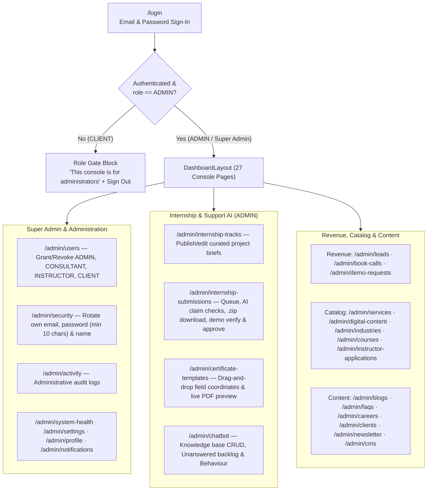
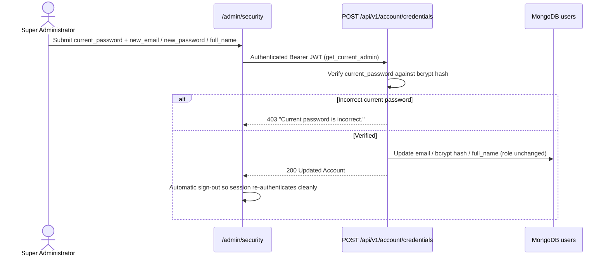
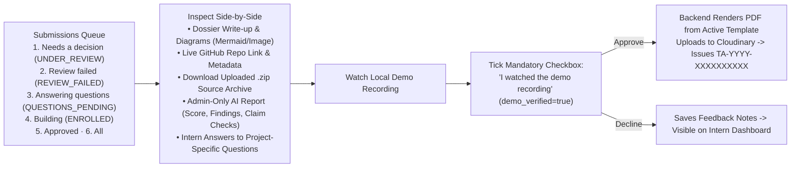
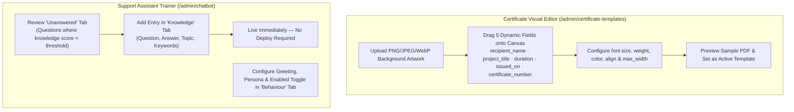

# Turnpike Admin — Super Admin & Operations Console

> **Client-rendered, role-gated administration and super-admin console** managing the internship programme, AI submission reviews, `.zip` source inspections, certificate templates, grounded support assistant, enterprise CMS, revenue leads, and user roles.  
> Built with **React 19**, **TanStack Start (`ssr: false`)**, **Recharts**, and **Tailwind CSS v4**, deployed to **Vercel** (`Root Directory: turnpike-admin`).

> **Full System Design (All Actors, Frontend, Backend & Data Flows):** [ARCHITECTURE.md](./ARCHITECTURE.md)  
> **Deployment Runbook:** [DEPLOYMENT.md](./DEPLOYMENT.md)

---

## Repository Layout

```text
├── turnpike-admin/                    # Console root (Vercel Root Directory)
│   ├── src/
│   │   ├── routes/
│   │   │   ├── __root.tsx             # HTML shell
│   │   │   ├── index.tsx              # Redirects / -> /admin
│   │   │   ├── login.tsx              # Staff email/password login
│   │   │   ├── admin.tsx              # Strict role gate (ADMIN check) + DashboardLayout
│   │   │   └── admin/                 # 27 console pages
│   │   ├── components/layout/         # AppSidebar, AppTopbar, DashboardLayout
│   │   ├── features/                  # Domain CRUD modal dialogs (services, blogs, users, etc.)
│   │   ├── constants/navigation.ts    # Role-filtered sidebar sections & route titles
│   │   ├── server.ts · start.ts · router.tsx
│   │   ├── styles.css                 # Tailwind v4 entry (@source self + shared)
│   │   └── vercel.json                # X-Frame-Options: DENY, X-Robots-Tag: noindex, nofollow
└── packages/shared/                   # @turnpike/shared (47 Radix UI primitives, Axios, Zustand, Tokens)
```

---

## What Admins & Super Admins See (Role Gate & 27 Console Pages)

Every route under `/admin/*` is wrapped by `admin.tsx` (`ssr: false`). Non-admin accounts (`CLIENT`) are blocked before the console mounts and offered an explanation + sign-out button.



---

## Super Administrator Lifecycle & Security Flow

The **first** administrator is bootstrapped once from `SUPER_ADMIN_EMAIL` / `SUPER_ADMIN_PASSWORD` on the backend **only when zero `ADMIN` accounts exist**. Once created, environment credentials are ignored, and changes happen securely from `/admin/security`:



---

## Internship Submission Review & Certificate Issuance Flow



> **Why `demo_verified` is enforced on the server:** No LLM can watch a video recording. The backend rejects any approval request unless an administrator explicitly confirms the local demo video runs.

---

## Certificate Designer & Support Assistant Training Flows



---

## Complete Console Route Map (27 Pages)

| Section | Routes | Allowed Roles |
|---|---|---|
| **Overview** | `/admin`, `/admin/system-health` | `ADMIN` (Dashboard visible to signed-in staff) |
| **Revenue** | `/admin/leads`, `/admin/book-calls`, `/admin/demo-requests` | `ADMIN`, `CONSULTANT` |
| **Catalog** | `/admin/services`, `/admin/digital-content`, `/admin/industries`, `/admin/courses`, `/admin/instructor-applications` | `ADMIN`, `CONSULTANT`, `INSTRUCTOR` (applications) |
| **Internship & AI** | `/admin/internship-tracks`, `/admin/internship-submissions`, `/admin/certificate-templates`, `/admin/chatbot` | `ADMIN` |
| **Content** | `/admin/blogs`, `/admin/faqs`, `/admin/careers`, `/admin/clients`, `/admin/clients/$industryName`, `/admin/newsletter`, `/admin/cms` | Staff (`ADMIN` / authorized) |
| **Administration** | `/admin/users`, `/admin/activity`, `/admin/security`, `/admin/profile`, `/admin/settings`, `/admin/notifications` | `ADMIN` (Users, Activity, Security) |

---

## Technologies Used in Turnpike Admin

| Category | Technologies & Libraries |
|---|---|
| **Framework & Routing** | React 19 (`react` 19.2), TanStack Start (`ssr: false`), TanStack Router, Nitro (`vercel` preset) |
| **Build & Tooling** | Vite 8, TypeScript 5.8, Bun Workspaces (`@turnpike/shared`), ESLint 9, Prettier 3 |
| **Styling & Design System** | Tailwind CSS v4 (`@tailwindcss/vite`), `tw-animate-css`, shared `oklch` CSS tokens (light & dark) |
| **UI, Charts & Diagrams** | 47 Radix UI primitives (`shadcn`), Recharts (`recharts` 2.15), Mermaid (`mermaid` 12.3), Lucide React, Motion, Sonner |
| **State, Forms & API** | TanStack React Query v5, Zustand v5 (persisted session), React Hook Form, Zod, Axios (silent 401 token refresh) |

---

## Local Development

```bash
bun install
cp turnpike-admin/.env.example turnpike-admin/.env   # set VITE_API_BASE_URL=http://127.0.0.1:8000
bun run dev                                          # http://localhost:3001
```

## Production Deployment (Vercel)

- **Root Directory:** `turnpike-admin`
- **Build Command:** Managed by `turnpike-admin/vercel.json` (`cd .. && bun install && cd turnpike-admin && NITRO_PRESET=vercel bun run build`)
- **Security Headers:** `X-Robots-Tag: noindex, nofollow`, `X-Frame-Options: DENY`, `X-Content-Type-Options: nosniff`, `Referrer-Policy: strict-origin-when-cross-origin`.

---

*Published from the Turnpike Analyst monorepo. See [ARCHITECTURE.md](./ARCHITECTURE.md) for the complete platform blueprint.*
